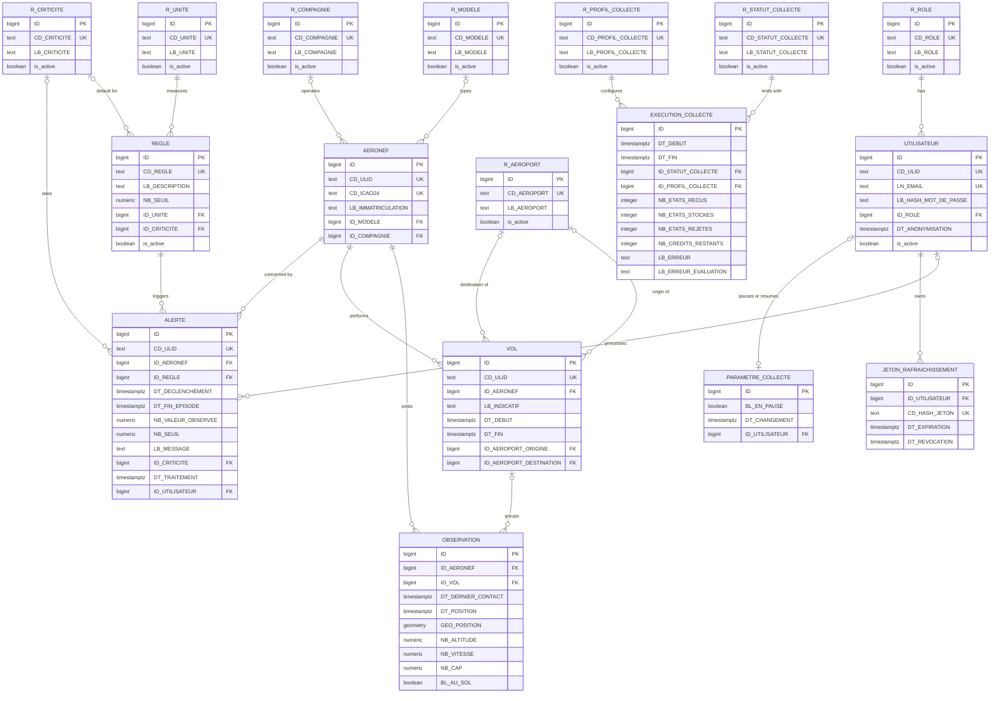

# Data model

Source: project sheet §4 to §6; specifications §VI.1.2, §VI.1.4, §VI.1.9 and §V.2 for the entity list; team decisions of 2026-11-03 (A-06, C-03, D-04, D-05, D-06, D-15, D-17, D-18); [decisions of 2026-11-06](#decisions-of-2026-11-06); collection decisions of 2026-11-09 in [open points](open-points.md#team-decisions-pending-confirmation).

This is the logical schema derived from the [class diagram](uml/class-diagram.md). It follows the [database conventions](database-conventions.md). The SQL is in [schema.sql](../db/schema.sql).

**Status: draft for team review.** The schema is implemented by the SQLAlchemy models in `src/api/models/` and the Alembic migrations in `src/api/database/migrations/` (one table or reference list per migration, each with its `down`). These are now the source of truth. `schema.sql` stays as the reviewed design and is not applied as is. Once a migration is merged it is never changed: a correction is a new migration (conventions §9).

## Tables

| Class | Table | Type | Summary |
|---|---|---|---|
| Aircraft | `AERONEF` | Business | ICAO24 address (business key), public ULID, registration, model, airline |
| Flight | `VOL` | Business | Observations of one aircraft with at most N minutes between them (D-06), public ULID, origin and destination airports |
| Observation | `OBSERVATION` | Business | One OpenSky state vector: last contact, position time, PostGIS position, altitude, speed, heading, on ground |
| Rule | `REGLE` | Business | Code, description, threshold, unit, default criticality; thresholds editable by the Supervisor (UC-05) |
| Alert | `ALERTE` | Business | Public ULID, aircraft, rule, trigger time, end of episode, observed value, threshold copied at trigger time, message, criticality, processing |
| User | `UTILISATEUR` | Business | Public ULID, email, argon2id password hash, role; anonymised, never deleted (A-06, D-17) |
| RefreshToken | `JETON_RAFRAICHISSEMENT` | Business | Hash of a refresh token, expiry, revocation |
| CollectionRun | `EXECUTION_COLLECTE` | Business | One OpenSky collection cycle: start (also the `now` given to the rules engine), end, status, profile, state vectors received, stored and rejected, credits left, collection error, evaluation error |
| CollectionParameter | `PARAMETRE_COLLECTE` | Business | Single row: whether the Supervisor paused the collection, when, and who |
| Role | `R_ROLE` | Reference | `USER`, `SUPERVISOR` |
| Criticality | `R_CRITICITE` | Reference | `LOW`, `MEDIUM`, `HIGH` |
| Unit | `R_UNITE` | Reference | `s`, `m/s`, `m/s²`, `°/s` |
| Model | `R_MODELE` | Reference | Aircraft models, from the OpenSky aircraft metadata |
| Airline | `R_COMPAGNIE` | Reference | Airlines, from the OpenSky aircraft metadata |
| Airport | `R_AEROPORT` | Reference | Origin and destination airports of flights |
| CollectionStatus | `R_STATUT_COLLECTE` | Reference | `SUCCESS`, `PARTIAL`, `FAILED`, `RATE_LIMITED`, `SKIPPED` |
| CollectionProfile | `R_PROFIL_COLLECTE` | Reference | `ILE_DE_FRANCE`, `FRANCE` |
| None | `audit_actions` | Technical | `create`, `update`, `delete` |
| None | `audit_logs` | Technical | Append-only log of threshold changes and anonymisations |

`SCORE_ANOMALIE` (AI module, bonus) is left out for now.

## Entity-relationship diagram

Technical columns (`created_at`, `updated_at`, `deleted_at`) are on every business table and omitted below. So are the `audit_actions` and `audit_logs` tables.

## Cardinalities

- An aircraft emits zero or more observations and performs zero or more flights; each belongs to exactly one aircraft.
- A flight groups one or more observations; an observation belongs to zero or one flight. Observations without a flight are not used by R3 to R5.
- An aircraft is concerned by zero or more alerts; a rule triggers zero or more alerts; an alert has exactly one aircraft and one rule.
- A rule has exactly one unit and zero or one default criticality. An alert has zero or one criticality.
- An alert is processed by zero or one user. A user has exactly one role and owns zero or more refresh tokens.
- An aircraft has zero or one model and zero or one airline. A flight has zero or one origin airport and zero or one destination airport.
- A collection cycle has exactly one status and one profile. The single row of `PARAMETRE_COLLECTE` records zero or one Supervisor, the last one who paused or resumed the collection.

## Table lifecycle

Nothing is deleted physically while the project runs. At the end of the project, the OpenSky data is removed with the database, as the OpenSky terms require.

| Table | Created by | Modified by | Deleted by | Expected volume |
|---|---|---|---|---|
| `AERONEF` | Collector, at the first observation of an ICAO24 address | Import of the OpenSky aircraft metadata, for the registration, model and airline | Nobody | One row per aircraft seen |
| `VOL` | Collector, when a new flight starts (D-06) | Collector, which closes the flight | Nobody | One row per flight |
| `OBSERVATION` | Collector, at each collection | Collector | Nobody: every observation is kept for the project, for the optional AI module | One row per aircraft and collection: 2 880 collections a day for Île-de-France every 30 s, 720 for metropolitan France every 120 s (D-05). As an assumption, 1 000 aircraft every 120 s give about 720 000 rows a day |
| `REGLE` | Initial data, then an `INSERT` for each new rule (NF-06) | Supervisor, for the threshold (UC-05) | Supervisor, through `deleted_at` | 5 rows at the start |
| `ALERTE` | Rules engine | Rules engine, for the end of episode; Supervisor, who marks it as processed (C-03) | Supervisor, through `deleted_at` | To measure during the first real collection, since it depends on the thresholds (D-04) |
| `UTILISATEUR` | The API, at registration | The API, including anonymisation on request (A-06) | Never: the row is anonymised | A few dozen accounts (estimate) |
| `JETON_RAFRAICHISSEMENT` | The API, at login | The API, which revokes it | Automatic task, through `deleted_at`, once the token has expired | One row per login |
| `audit_logs` | The API, in the transaction of the audited change | Nobody: a trigger rejects any change | Nobody | One row per threshold change or anonymisation |
| `EXECUTION_COLLECTE` | Collector, at the start of each cycle, also when the collection is paused (status `SKIPPED`) | Collector, during its own cycle only: counts, credits left, status, errors, then `DT_FIN`, written last, after the rules evaluation. Once `DT_FIN` is set, nobody modifies the row | Nobody | One row per cycle: 2 880 a day for Île-de-France every 30 s, 720 for metropolitan France every 120 s |
| `PARAMETRE_COLLECTE` | A migration, which inserts the single row (not paused) | Supervisor, through the API, to pause or resume the collection; the collector only reads it | Nobody | Exactly one row, enforced by a unique index on a constant |

## Deviation from the guide

The [conventions](database-conventions.md#15-traces-geometry-and-drawings-p-17-and-18) ask for one row per trace, never a table of points. `OBSERVATION` keeps one point per row on purpose (decided on 2026-11-06):

- each point is a measurement with its own times, altitude, speed, heading and on-ground status, which a `LINESTRING` cannot hold;
- R1 and R2 read the latest observation, and R3 to R5 compare two consecutive observations;
- observations arrive one at a time, so a trace would be rewritten at each collection.

The trajectory of a flight is read through the (`ID_VOL`, `DT_POSITION`) index, so no trace is stored on `VOL`.

## Integrity constraints

| Table | Constraint |
|---|---|
| All | `ID` is `BIGINT GENERATED ALWAYS AS IDENTITY` |
| All | Every foreign key is `ON DELETE RESTRICT`. Nothing is deleted physically: business tables use `deleted_at`, reference tables `is_active`, users are anonymised |
| `AERONEF`, `VOL`, `ALERTE`, `UTILISATEUR` | `CD_ULID` is unique and has 26 Crockford base 32 characters; the application generates it |
| `AERONEF` | `CD_ICAO24` is unique and has 6 lowercase hexadecimal characters |
| `VOL` | `DT_FIN` is on or after `DT_DEBUT` when known, since a flight can hold a single observation |
| `OBSERVATION` | Unique pair (`ID_AERONEF`, `DT_DERNIER_CONTACT`), so the same state vector is never stored twice |
| `OBSERVATION` | Foreign key (`ID_VOL`, `ID_AERONEF`) to `VOL` (`ID`, `ID_AERONEF`), so a flight always belongs to the aircraft of its observations |
| `OBSERVATION` | `DT_POSITION` ≤ `DT_DERNIER_CONTACT`; `NB_VITESSE` ≥ 0; `NB_CAP` from 0 to under 360 |
| `REGLE` | `CD_REGLE` is unique and free text, so R6 can be added with an `INSERT` (NF-06); `NB_SEUIL` ≥ 0 |
| `ALERTE` | `DT_TRAITEMENT` and `ID_UTILISATEUR` are both set or both empty (C-03) |
| `ALERTE` | `DT_FIN_EPISODE` is on or after `DT_DECLENCHEMENT`; an aircraft has at most one open alert per rule, so a situation that lasts raises a single alert, also after a restart of the engine |
| `audit_logs` | Append-only: triggers reject `UPDATE`, `DELETE` and `TRUNCATE`, and the application user only has `SELECT` and `INSERT` |
| `UTILISATEUR` | `LN_EMAIL` is unique; the password hash may only be empty once the account is anonymised |
| `JETON_RAFRAICHISSEMENT` | `CD_HASH_JETON` is unique; only the hash is stored |
| `EXECUTION_COLLECTE` | `DT_FIN` is on or after `DT_DEBUT` when known; `NB_ETATS_RECUS`, `NB_ETATS_STOCKES` and `NB_ETATS_REJETES` default to 0 and are never negative |
| `PARAMETRE_COLLECTE` | A single row: the unique index `uq_parametre_collecte_ligne_unique` on the constant `true` rejects any second row |

`updated_at` is kept current by a `BEFORE UPDATE` trigger on every business table.

## Indexes

Every foreign key is indexed, except `OBSERVATION.ID_AERONEF`, which is the first column of the unique pair.

| Index | Why |
|---|---|
| `OBSERVATION` (`ID_AERONEF`, `DT_DERNIER_CONTACT`), unique | History of one aircraft and its latest observation (R1, R2) |
| `OBSERVATION` (`ID_VOL`, `DT_POSITION`) | Trajectory of a flight (BF-05, BF-07), consecutive points for R3 to R5 |
| `OBSERVATION` (`DT_DERNIER_CONTACT`) | The engine reads the latest observations after each collection (BF-09) |
| `OBSERVATION` GiST (`GEO_POSITION`) | Search by area (UC-01, D-18) |
| `OBSERVATION` (`ID_VOL`, `DT_DERNIER_CONTACT`) | Latest contact of each open flight, read at each collection to group the observations and close the stale flights (D-06) |
| `VOL` (`ID_AERONEF`, `DT_DEBUT`) | Flights of one aircraft |
| `VOL` (`ID_AERONEF`), on open flights only (`DT_FIN IS NULL`) | Open flights of the aircraft received, read at each collection |
| `VOL` (`ID`, `ID_AERONEF`), unique | Target of the composite foreign key from `OBSERVATION` |
| `AERONEF` GIN (`LB_IMMATRICULATION`), `R_COMPAGNIE` GIN (`LB_COMPAGNIE`), with `pg_trgm` | "Contains" search on aircraft (BF-04) |
| `ALERTE` (`ID_AERONEF`, `ID_REGLE`), unique, on open alerts only | One open episode per aircraft and rule |
| `audit_logs` (`table_name`, `record_id`), and one per foreign key | History of one row |
| `ALERTE` (`DT_DECLENCHEMENT`), and one per foreign key | Filter and sort alerts on the dashboard (BF-12) |
| `EXECUTION_COLLECTE` (`DT_DEBUT`) | Latest cycle on the dashboard and history newest first, paged by `DT_DEBUT` (keyset); PostgreSQL reads the B-tree backwards for `ORDER BY "DT_DEBUT" DESC` |
| `EXECUTION_COLLECTE` (`ID_STATUT_COLLECTE`, `DT_DEBUT`) | Latest successful cycle, without reading back through the skipped ones; also indexes the foreign key to `R_STATUT_COLLECTE` |
| One per foreign key on `AERONEF`, `VOL`, `REGLE`, `UTILISATEUR`, `JETON_RAFRAICHISSEMENT`, `EXECUTION_COLLECTE`, `PARAMETRE_COLLECTE` | Conventions: foreign keys are never indexed automatically |

## Initial data

| Rule | Description | Threshold | Unit | Criticality |
|---|---|---|---|---|
| R1 | Too long a delay since the last contact | 300 | s | Medium |
| R2 | A position that has become too old | 600 | s | Low |
| R3 | A large change in altitude | 30 | m/s | High |
| R4 | A large change in speed | 2 | m/s² | Medium |
| R5 | A large change in heading | 5 | °/s | Medium |

These thresholds are a proposal (D-04). The calculation window (10 s ≤ Δt ≤ 300 s) and the minimum speed of 50 m/s for R5 are fixed parameters of the rule code, not stored. See [business rules](business-rules.md).

Collection reference rows:

| Table | Code | Label |
|---|---|---|
| `R_STATUT_COLLECTE` | `SUCCESS` | Succès |
| `R_STATUT_COLLECTE` | `PARTIAL` | Partiel |
| `R_STATUT_COLLECTE` | `FAILED` | Échec |
| `R_STATUT_COLLECTE` | `RATE_LIMITED` | Quota OpenSky atteint |
| `R_STATUT_COLLECTE` | `SKIPPED` | Ignorée, collecte en pause |
| `R_PROFIL_COLLECTE` | `ILE_DE_FRANCE` | Île-de-France, toutes les 30 s |
| `R_PROFIL_COLLECTE` | `FRANCE` | France métropolitaine, toutes les 120 s |

The period and the bounding box of each profile are settings of the collector, not columns: the table only lets each cycle record which profile it used. `PARAMETRE_COLLECTE` starts with one row, not paused.

## Data rules

- Source: data comes from the OpenSky Network. The collector cleans and validates it (§VII.1), then stores it.
- History: stored history allows trajectory reconstruction and analysis even when OpenSky is unavailable (NF-04).
- Units: altitude in metres, speed in metres per second, heading in degrees, as provided by OpenSky. Positions in WGS 84 (SRID 4326).
- Positions: the collector rounds coordinates to 6 decimals, about 11 cm.
- Altitude: `NB_ALTITUDE` holds the barometric altitude, or the geometric altitude when the barometric one is missing (decided on 2026-11-09).
- Aircraft on the ground are stored like the others; the rules decide whether to ignore them (decided on 2026-11-09).
- Aircraft details: the registration, model and airline come from the OpenSky aircraft metadata, joined on the ICAO24 address. Its terms of use are to be checked before the import. The import, like the origin and destination airports of flights, is postponed until after the first collection pull request (decided on 2026-11-09).
- Reading data: a base repository class on SQLAlchemy excludes soft-deleted rows from every read. Reading a deleted row must be requested explicitly.
- Public identifiers: the API exposes `CD_ULID`, never `ID`. The `BIGINT` key stays internal and is used for joins.
- Heading: `NB_CAP` keeps 2 decimals and stays under 360. The collector rounds the heading to 2 decimals, then turns 360 into 0, since both are the same heading. Otherwise a value such as 359.996 is rounded to 360.00 by the column and the whole observation is rejected.
- Flights: an observation joins the current flight of its aircraft when at most N minutes separate it from the previous one; otherwise a new flight starts (D-06). N is a setting of the collector, `COLLECTION_FLIGHT_GAP_MINUTES`, set to 30 minutes (decided on 2026-11-09).

## Personal data

Personal data is limited to `UTILISATEUR`: email address and password hash. A deletion request anonymises the row (email replaced by `anonyme-<CD_ULID>@aerosafe.invalid`, hash removed, `DT_ANONYMISATION` set, refresh tokens revoked) so that alerts processed by this user stay consistent. See [project terms](project-terms.md).

The email address is not encrypted: this is an educational project with few accounts, and the password is already hashed.

## Decisions of 2026-11-06

| Point | Decision |
|---|---|
| Retention of observations | Every observation is kept for the project, to feed the optional AI module |
| Size of `OBSERVATION` | No partitioning; the size of the table is monitored during collection |
| Deletion | Only the Supervisor deletes rules and alerts, and an automatic task deletes expired refresh tokens, always through `deleted_at` |
| Reference data | Airports, airlines and models move to `R_AEROPORT`, `R_COMPAGNIE` and `R_MODELE` |
| Search | "Contains" search with `pg_trgm` |
| Audit | `audit_logs` records threshold changes and anonymisations. Processing an alert is already traced on `ALERTE` |
| Public identifiers | ULID on `AERONEF`, `VOL`, `ALERTE` and `UTILISATEUR` |
| Duplicate alerts | `DT_FIN_EPISODE` on `ALERTE` |

## Points to settle

| Point | Proposal |
|---|---|
| `on_ground` | The team rules use it but the class diagram does not list it. Added here as `BL_AU_SOL`; the class diagram should be updated |
| Default criticality per rule | The class diagram links criticality to the alert only. `REGLE.ID_CRITICITE` is added so the engine knows which criticality to copy |
| Uppercase names | PostgreSQL folds unquoted names to lowercase, so `schema.sql` as written would create `r_role`, not `R_ROLE`. The conventions require uppercase, so the migrations and the models quote every uppercase name. Raw SQL must quote them too: `SELECT "CD_ROLE" FROM "R_ROLE"`. Technical names stay lowercase and unquoted |
