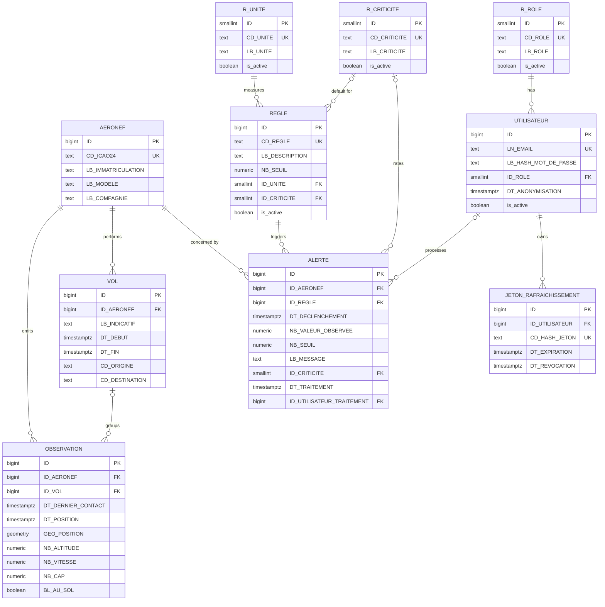

# Data model

Source: project sheet §4 to §6; specifications §VI.1.2, §VI.1.4, §VI.1.9 and §V.2 for the entity list; team decisions of 2026-11-03 (A-06, C-03, D-04, D-06, D-15, D-17, D-18).

This is the logical schema derived from the [class diagram](uml/class-diagram.md). It follows the [database conventions](database-conventions.md). The SQL is in [schema.sql](../db/schema.sql).

**Status: draft for team review.** Once validated, `schema.sql` is split into Alembic migrations in `src/api/database/migrations/` (one change per migration, each with its `down`, reference data in its own migration). It is not applied as is.

## Tables

| Class | Table | Type | Summary |
|---|---|---|---|
| Aircraft | `AERONEF` | Business | ICAO24 address (business key), registration, model, airline |
| Flight | `VOL` | Business | Observations of one aircraft with at most N minutes between them (D-06) |
| Observation | `OBSERVATION` | Business | One OpenSky state vector: last contact, position time, PostGIS position, altitude, speed, heading, on ground |
| Rule | `REGLE` | Business | Code, description, threshold, unit, default criticality; thresholds editable by the Supervisor (UC-05) |
| Alert | `ALERTE` | Business | Aircraft, rule, trigger time, observed value, threshold copied at trigger time, message, criticality, processing |
| User | `UTILISATEUR` | Business | Email, argon2id password hash, role; anonymised, never deleted (A-06, D-17) |
| RefreshToken | `JETON_RAFRAICHISSEMENT` | Business | Hash of a refresh token, expiry, revocation |
| Role | `R_ROLE` | Reference | `USER`, `SUPERVISOR` |
| Criticality | `R_CRITICITE` | Reference | `LOW`, `MEDIUM`, `HIGH` |
| Unit | `R_UNITE` | Reference | `s`, `m/s`, `m/s²`, `°/s` |

`SCORE_ANOMALIE` (AI module, bonus) and the audit table `audit_logs` are left out for now.

## Entity-relationship diagram

Technical columns (`created_at`, `updated_at`, `deleted_at`) are on every business table and omitted below.

## Cardinalities

- An aircraft emits zero or more observations and performs zero or more flights; each belongs to exactly one aircraft.
- A flight groups one or more observations; an observation belongs to zero or one flight. Observations without a flight are not used by R3 to R5.
- An aircraft is concerned by zero or more alerts; a rule triggers zero or more alerts; an alert has exactly one aircraft and one rule.
- A rule has exactly one unit and zero or one default criticality. An alert has zero or one criticality.
- An alert is processed by zero or one user. A user has exactly one role and owns zero or more refresh tokens.

## Integrity constraints

| Table | Constraint |
|---|---|
| All | `ID` is `BIGINT` (`SMALLINT` for reference tables) `GENERATED ALWAYS AS IDENTITY` |
| All | Every foreign key is `ON DELETE RESTRICT`. Nothing is deleted physically: business tables use `deleted_at`, reference tables `is_active`, users are anonymised |
| `AERONEF` | `CD_ICAO24` is unique and has 6 lowercase hexadecimal characters |
| `VOL` | `DT_FIN` is after `DT_DEBUT` when known |
| `OBSERVATION` | Unique pair (`ID_AERONEF`, `DT_DERNIER_CONTACT`), so the same state vector is never stored twice |
| `OBSERVATION` | `DT_POSITION` ≤ `DT_DERNIER_CONTACT`; `NB_VITESSE` ≥ 0; `NB_CAP` from 0 to under 360 |
| `REGLE` | `CD_REGLE` is unique and free text, so R6 can be added with an `INSERT` (NF-06); `NB_SEUIL` ≥ 0 |
| `ALERTE` | `DT_TRAITEMENT` and `ID_UTILISATEUR_TRAITEMENT` are both set or both empty (C-03) |
| `UTILISATEUR` | `LN_EMAIL` is unique; the password hash may only be empty once the account is anonymised |
| `JETON_RAFRAICHISSEMENT` | `CD_HASH_JETON` is unique; only the hash is stored |

`updated_at` is kept current by a `BEFORE UPDATE` trigger on every business table.

## Indexes

Every foreign key is indexed, except `OBSERVATION.ID_AERONEF`, which is the first column of the unique pair.

| Index | Why |
|---|---|
| `OBSERVATION` (`ID_AERONEF`, `DT_DERNIER_CONTACT`), unique | History of one aircraft and its latest observation (R1, R2) |
| `OBSERVATION` (`ID_VOL`, `DT_POSITION`) | Trajectory of a flight (BF-05, BF-07), consecutive points for R3 to R5 |
| `OBSERVATION` (`DT_DERNIER_CONTACT`) | The engine reads the latest observations after each collection (BF-09) |
| `OBSERVATION` GiST (`GEO_POSITION`) | Search by area (UC-01, D-18) |
| `VOL` (`ID_AERONEF`, `DT_DEBUT`) | Flights of one aircraft |
| `AERONEF` (`LB_IMMATRICULATION`), (`LB_COMPAGNIE`) | Aircraft search (BF-04) |
| `ALERTE` (`DT_DECLENCHEMENT`), and one per foreign key | Filter and sort alerts on the dashboard (BF-12) |
| One per foreign key on `REGLE`, `UTILISATEUR`, `JETON_RAFRAICHISSEMENT` | Conventions: foreign keys are never indexed automatically |

## Initial data

| Rule | Description | Threshold | Unit | Criticality |
|---|---|---|---|---|
| R1 | Too long a delay since the last contact | 300 | s | Medium |
| R2 | A position that has become too old | 600 | s | Low |
| R3 | A large change in altitude | 30 | m/s | High |
| R4 | A large change in speed | 2 | m/s² | Medium |
| R5 | A large change in heading | 5 | °/s | Medium |

These thresholds are a proposal (D-04). The calculation window (10 s ≤ Δt ≤ 300 s) and the minimum speed of 50 m/s for R5 are fixed parameters of the rule code, not stored. See [business rules](business-rules.md).

## Data rules

- Source: data comes from the OpenSky Network. The collector cleans and validates it (§VII.1), then stores it.
- History: stored history allows trajectory reconstruction and analysis even when OpenSky is unavailable (NF-04).
- Units: altitude in metres, speed in metres per second, heading in degrees, as provided by OpenSky. Positions in WGS 84 (SRID 4326).
- Flights: an observation joins the current flight of its aircraft when at most N minutes separate it from the previous one; otherwise a new flight starts (D-06). N is a setting of the collector.

## Personal data

Personal data is limited to `UTILISATEUR`: email address and password hash. A deletion request anonymises the row (neutral email, hash removed, `DT_ANONYMISATION` set, refresh tokens revoked) so that alerts processed by this user stay consistent. See [project terms](project-terms.md).

## Points to settle

| Point | Proposal |
|---|---|
| Prefix of the geometry column | The guide defines no prefix for a geometry. `GEO_POSITION` uses a new `GEO_` prefix, to confirm and add to the conventions |
| Deduplication of alerts | The same rule must not raise a second alert while the situation lasts. Handled by the engine for now; a nullable `DT_FIN_EPISODE` on `ALERTE` can be added if it must survive a restart |
| `on_ground` | The team rules use it but the class diagram does not list it. Added here as `BL_AU_SOL`; the class diagram should be updated |
| Default criticality per rule | The class diagram links criticality to the alert only. `REGLE.ID_CRITICITE` is added so the engine knows which criticality to copy |
