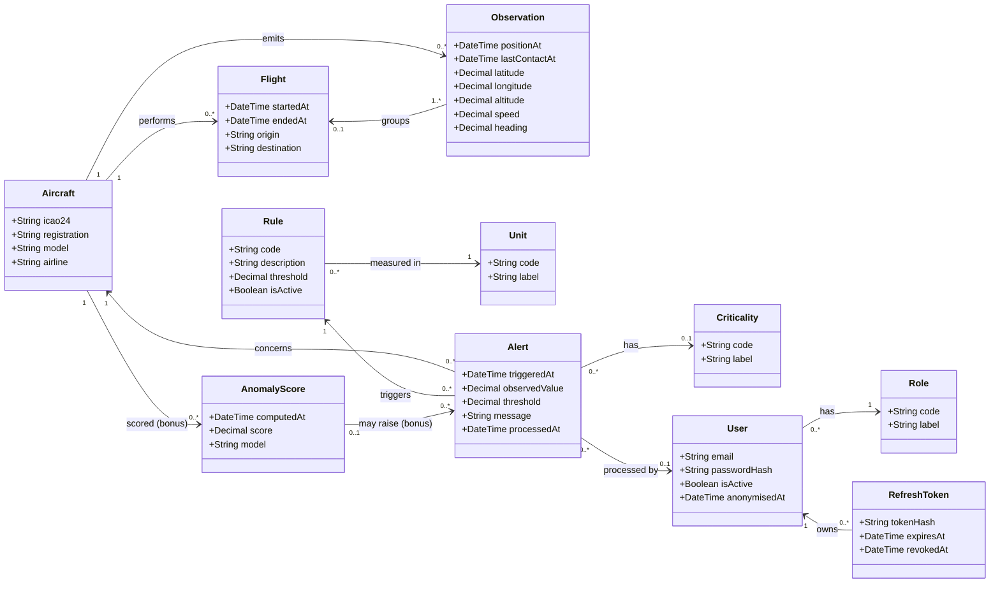

# Class diagram

Source: project sheet §4 to §7, with the team decisions of 2026-11-03 listed in [open points](../open-points.md). This is the conceptual domain model, in English. The logical schema follows the [database conventions](../database-conventions.md); the mapping to table names is given below.

## Design choices

| Choice | Reason |
| --- | --- |
| `Observation` has two timestamps, `lastContactAt` and `positionAt` | Rule R1 measures the time since the last message, and R2 the age of the last known position (A-01) |
| `Flight` is an explicit entity | Team decision (D-06): it groups the observations of an aircraft by time continuity (criterion below) |
| An observation belongs to at most one flight | Observations that fit no flight stay without one |
| `Rule` stores its threshold and unit | The Supervisor can modify thresholds (UC-05), so they are persisted |
| `Alert` copies the threshold at trigger time | A later threshold change must not rewrite the explanation of an alert already raised |
| `Alert.processedAt` and `Alert.processedBy` | An alert is processed when `processedAt` is set. No separate state, so no redundancy; it records who processed it and when (C-03, team decision) |
| `Criticality` is optional | The project sheet makes the criticality level optional |
| `User` holds the credentials | Authentication is built in the API (A-06). The row stores the email and the argon2id hash of the password |
| `User` is anonymised, never deleted | A deletion request overwrites email, name and password hash and sets `anonymisedAt`; the row stays so that alerts processed by this user remain consistent (database guide: pseudonymisation, no physical delete) |
| `RefreshToken` stores only a hash | The token itself lives in an `HttpOnly` cookie; the hash allows revocation at logout, deactivation or anonymisation |
| `Role` and `Unit` and `Criticality` are classes | Value lists are reference tables, never an enum ([database conventions](../database-conventions.md) §5) |
| `AnomalyScore` is optional | AI module (bonus, project sheet §7) |
| Position is a PostGIS `geometry` | Decided (D-18): the area search of UC-01 queries by location, so the guide requires PostGIS. Latitude and longitude are derived from the geometry in the conceptual model above |
| `Flight` groups observations by continuity | Decided (D-06): same `icao24`, and no more than N minutes between two consecutive observations, otherwise a new flight starts. N is a setting, default to be fixed with the rules |

## Mapping to tables

Names follow the [database conventions](../database-conventions.md): uppercase, French, singular, `R_` for reference tables.

| Class | Table | Type |
| --- | --- | --- |
| Aircraft | `AERONEF` | Business |
| Observation | `OBSERVATION` | Business |
| Flight | `VOL` | Business |
| Rule | `REGLE` | Business (thresholds are modified by the application) |
| Alert | `ALERTE` | Business |
| User | `UTILISATEUR` | Business (not `W_`: that prefix is for temporary or import tables) |
| RefreshToken | `JETON_RAFRAICHISSEMENT` | Business |
| AnomalyScore | `SCORE_ANOMALIE` | Business |
| Unit | `R_UNITE` | Reference |
| Criticality | `R_CRITICITE` | Reference |
| Role | `R_ROLE` | Reference |

Column names, keys, indexes and comments are defined when the logical schema is written. Decided for D-15: technical columns keep the English names of the guide (`created_at`, `updated_at`, `deleted_at`, `is_active`) and the audit table is `audit_logs`.
