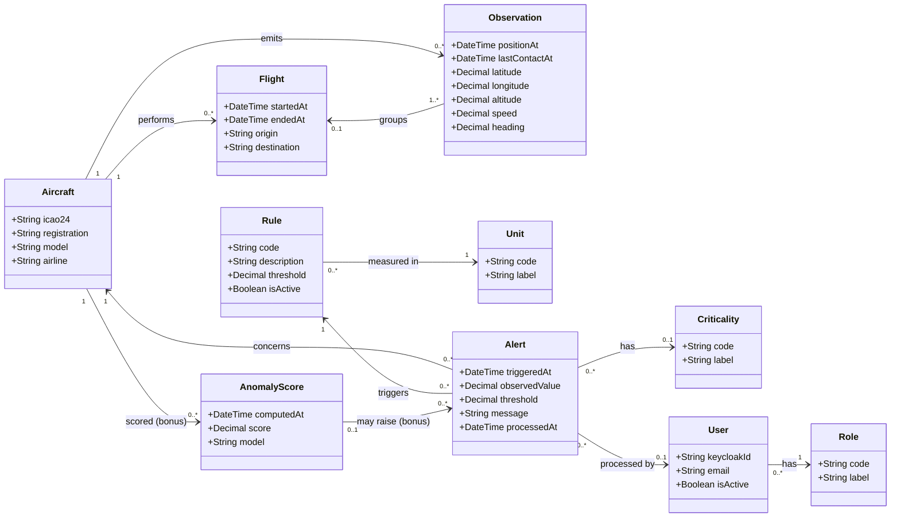

# Class diagram

Source: project sheet §4 to §7, with the team decisions of 2026-11-03 listed in [open points](../open-points.md). This is the conceptual domain model, in English. The logical schema follows the [database conventions](../database-conventions.md); the mapping to table names is given below.

## Design choices

| Choice | Reason |
| --- | --- |
| `Observation` has two timestamps, `lastContactAt` and `positionAt` | Rule R1 measures the time since the last message, and R2 the age of the last known position (A-01) |
| `Flight` is an explicit entity | Team decision (D-06): it groups the observations of an aircraft by time continuity, the criterion being `TBD` |
| An observation belongs to at most one flight | Observations that fit no flight stay without one |
| `Rule` stores its threshold and unit | The Supervisor can modify thresholds (UC-05), so they are persisted |
| `Alert` copies the threshold at trigger time | A later threshold change must not rewrite the explanation of an alert already raised |
| `Alert.processedAt` and `Alert.processedBy` | An alert is processed when `processedAt` is set. No separate state, so no redundancy; it records who processed it and when (C-03, team decision) |
| `Criticality` is optional | The project sheet makes the criticality level optional |
| `User` mirrors Keycloak | The local row is linked to Keycloak by `keycloakId`. Passwords stay in Keycloak. The row holds what the application needs to link data to an account, like the `Member` table of `planificateur_ldt` |
| `Role` and `Unit` and `Criticality` are classes | Value lists are reference tables, never an enum ([database conventions](../database-conventions.md) §5) |
| `AnomalyScore` is optional | AI module (bonus, project sheet §7) |
| Position is stored as latitude and longitude here | The guide requires PostGIS when a position is queried by location, which the area search of UC-01 does; the choice is left to the logical schema (D-18) |

## Mapping to tables

Names follow the [database conventions](../database-conventions.md): uppercase, French, singular, `R_` for reference tables.

| Class | Table | Type |
| --- | --- | --- |
| Aircraft | `AERONEF` | Business |
| Observation | `OBSERVATION` | Business |
| Flight | `VOL` | Business |
| Rule | `REGLE` | Business (thresholds are modified by the application) |
| Alert | `ALERTE` | Business |
| User | `UTILISATEUR` | Business |
| AnomalyScore | `SCORE_ANOMALIE` | Business |
| Unit | `R_UNITE` | Reference |
| Criticality | `R_CRITICITE` | Reference |
| Role | `R_ROLE` | Reference |

Column names, keys, indexes and comments are defined when the logical schema is written (see D-15 for the timestamp columns).
