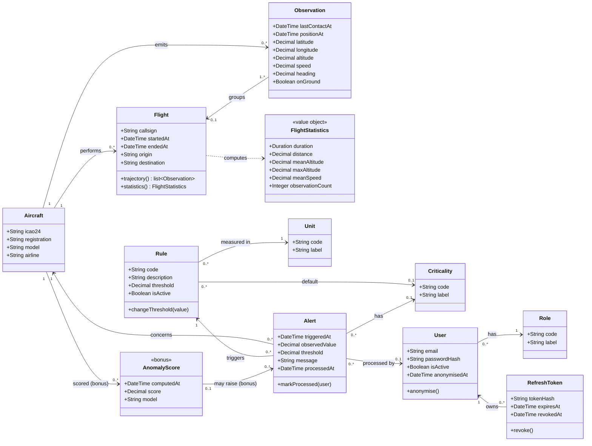
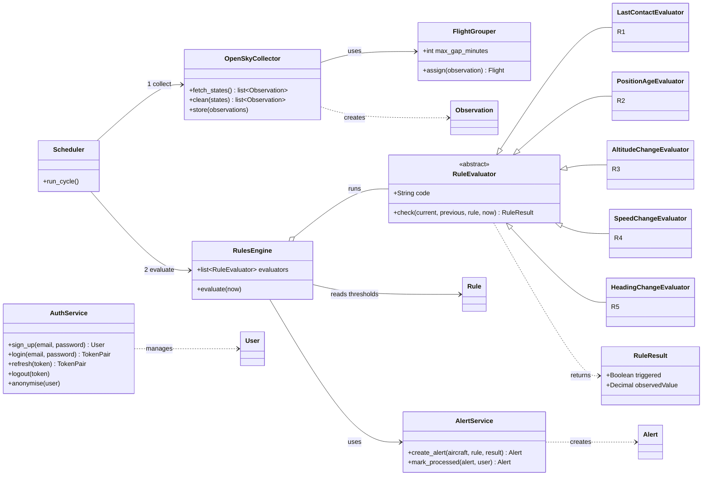

# Class diagram

Source: specifications §VI.1.9 and §VI.1.10 (Aircraft, Observation, Flight, Rule, Alert, User), project sheet §4 to §7, [business rules](../business-rules.md), the team decisions of 2026-11-03 listed in [open points](../open-points.md) and the [data model](../data-model.md) (schema `db/schema.sql`), which this diagram follows table by table.

The model is split in two diagrams: the domain classes, which are persisted and match the tables, and the service classes, which hold the logic.

## Domain classes

Attribute names are conceptual (English, camel case). Table and column names are given in the [mapping](#mapping-to-tables-and-columns). Technical columns (`created_at`, `updated_at`, `deleted_at`) are on every business table and omitted here.

### Design choices

| Choice | Reason |
| --- | --- |
| `Observation` has `lastContactAt` and `positionAt` | R1 measures the time since the last message and R2 the age of the last position (A-01). A single timestamp could not tell them apart |
| `Observation.onGround` | The rules only apply to airborne aircraft ([business rules](../business-rules.md)) |
| `Observation.latitude` and `longitude` | Stored as one PostGIS point (`GEO_POSITION`, D-18); the two values are derived from it |
| `Flight` is explicit and has a `callsign` | Team decision D-06; `VOL.LB_INDICATIF` holds the OpenSky callsign |
| An observation belongs to at most one flight | Observations that fit no flight stay without one |
| `Rule` stores its threshold, unit and default criticality | The Supervisor changes thresholds (UC-05); `REGLE.ID_CRITICITE` tells the engine which criticality to copy into the alert |
| `Alert` copies the threshold at trigger time | A later threshold change must not rewrite the explanation of an alert already raised |
| `Alert.processedAt` and `processedBy`, no status field | Team decision C-03: an alert is processed when `processedAt` is set, so there is no redundant state. Both are set or both empty |
| `Criticality` is optional | The project sheet makes the criticality level optional |
| `Criticality`, `Unit` and `Role` are classes | Value lists are reference tables, never an enum ([database conventions](../database-conventions.md) §5) |
| `User` holds an argon2id hash and is anonymised, never deleted | Authentication is built in the API (A-06); a deletion request anonymises the row so processed alerts stay consistent (C-05) |
| `RefreshToken` stores only a hash | The token itself lives in an `HttpOnly` cookie; the hash allows revocation |
| `AnomalyScore` is optional | AI module (bonus). It has no table in `schema.sql` yet, see [points for the team](#points-for-the-team) |

## Service and rule classes

These classes hold the logic and are not persisted, as required by the object-oriented rule in [contributing](../../CONTRIBUTING.md). A rule is split in two: the `Rule` row holds the parameters (threshold, unit, criticality), and a `RuleEvaluator` subclass holds the calculation.

### Notes

- `RuleEvaluator` is abstract: R1 to R5 are subclasses with the same `check` method, and the engine only knows that interface. A new rule is a new subclass plus one `REGLE` row, with no change to the existing rules (NF-06, §VI.1.5).
- `check` receives the latest observation, the previous one of the same flight (unused by R1 and R2), the `Rule` holding the threshold, and `now`, the time of the collection that has just run. It never reads the database, so every rule is tested with one triggering case and one non-triggering case (§IX.2).
- `RulesEngine` loads the active rules from the database, matches each one to its evaluator by `code`, and skips aircraft on the ground. It raises no second alert for the same aircraft and rule while the situation lasts.
- `Scheduler` runs the collection, then the evaluation, at the period of the active profile: 30 s or 120 s (D-05).
- `FlightGrouper` attaches an observation to the current flight of its aircraft when at most N minutes separate it from the previous one, otherwise it starts a new flight (D-06).

## Mapping to tables and columns

Names follow the [database conventions](../database-conventions.md). Columns are those of `db/schema.sql`. Decided for D-15: technical columns keep the English names of the guide (`created_at`, `updated_at`, `deleted_at`, `is_active`) and the audit table is `audit_logs`.

| Class | Table | Attribute | Column |
| --- | --- | --- | --- |
| Aircraft | `AERONEF` | icao24, registration, model, airline | `CD_ICAO24`, `LB_IMMATRICULATION`, `LB_MODELE`, `LB_COMPAGNIE` |
| Flight | `VOL` | callsign, startedAt, endedAt, origin, destination; aircraft | `LB_INDICATIF`, `DT_DEBUT`, `DT_FIN`, `CD_ORIGINE`, `CD_DESTINATION`; `ID_AERONEF` |
| Observation | `OBSERVATION` | lastContactAt, positionAt, latitude and longitude, altitude, speed, heading, onGround; aircraft, flight | `DT_DERNIER_CONTACT`, `DT_POSITION`, `GEO_POSITION`, `NB_ALTITUDE`, `NB_VITESSE`, `NB_CAP`, `BL_AU_SOL`; `ID_AERONEF`, `ID_VOL` |
| Rule | `REGLE` | code, description, threshold, isActive; unit, default criticality | `CD_REGLE`, `LB_DESCRIPTION`, `NB_SEUIL`, `is_active`; `ID_UNITE`, `ID_CRITICITE` |
| Alert | `ALERTE` | triggeredAt, observedValue, threshold, message, processedAt; aircraft, rule, criticality, processedBy | `DT_DECLENCHEMENT`, `NB_VALEUR_OBSERVEE`, `NB_SEUIL`, `LB_MESSAGE`, `DT_TRAITEMENT`; `ID_AERONEF`, `ID_REGLE`, `ID_CRITICITE`, `ID_UTILISATEUR_TRAITEMENT` |
| User | `UTILISATEUR` | email, passwordHash, isActive, anonymisedAt; role | `LN_EMAIL`, `LB_HASH_MOT_DE_PASSE`, `is_active`, `DT_ANONYMISATION`; `ID_ROLE` |
| RefreshToken | `JETON_RAFRAICHISSEMENT` | tokenHash, expiresAt, revokedAt; user | `CD_HASH_JETON`, `DT_EXPIRATION`, `DT_REVOCATION`; `ID_UTILISATEUR` |
| Role | `R_ROLE` | code, label | `CD_ROLE`, `LB_ROLE` |
| Criticality | `R_CRITICITE` | code, label | `CD_CRITICITE`, `LB_CRITICITE` |
| Unit | `R_UNITE` | code, label | `CD_UNITE`, `LB_UNITE` |
| AnomalyScore (bonus) | `SCORE_ANOMALIE` | computedAt, score, model | not in `schema.sql` yet |
| FlightStatistics | none | | Computed from the observations of a flight, not stored |

## Points for the team

| Point | Detail | Proposal |
| --- | --- | --- |
| Observed value and threshold of an alert | `schema.sql` allows `NB_VALEUR_OBSERVEE` and `NB_SEUIL` to be empty (team decision A-03), but specifications §VI.1.6 lists them among the minimum content of an alert | Make both `NOT NULL`: the engine fills them for every rule R1 to R5 anyway, and the schema then satisfies both documents |
| `SCORE_ANOMALIE` | Present in this diagram as a bonus class, absent from the schema | Add the table when the AI module starts, or add it now as an optional table |
| Collection state on the Dashboard | The Dashboard shows the last collection and its errors (A-04) but no table stores them | Decide whether the state is kept in a table or only in the logs |
