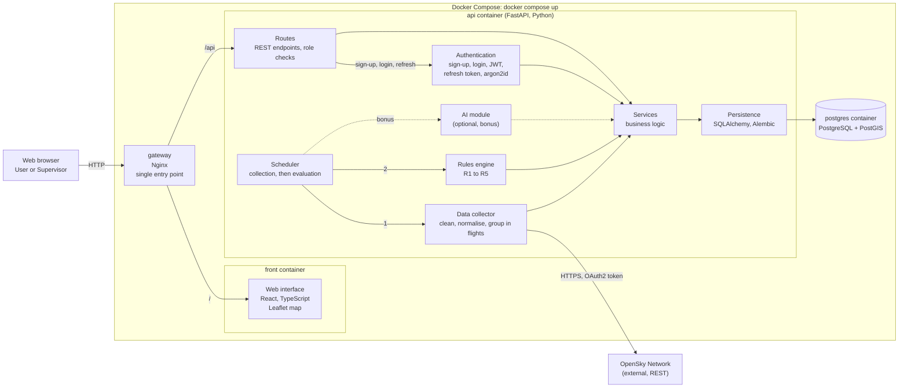

# Component diagram

Source: specifications §VII.1 (authentication, web interface, FastAPI API, PostgreSQL database, rules engine, optional AI module), project sheet §8, [technology choices](../technology-choices.md), the team decisions of 2026-11-03 listed in [open points](../open-points.md) and `docker-compose.yaml`.

## Components

The first column lists the six components named by the specifications (§VII.1).

| Specifications §VII.1 | Component | Role | Technology |
| --- | --- | --- | --- |
| Web interface | Web interface | Search, trajectories on a map, statistics, Dashboard, alert and account management | React, TypeScript, Leaflet |
| | Gateway | Single entry point: routes `/` to the interface and `/api` to the API | Nginx |
| Authentication | Authentication | Sign-up, login, logout, refresh, password hashing, roles `User` and `Supervisor` | FastAPI, JWT (about 15 minutes), refresh token in an `HttpOnly` cookie, argon2id |
| FastAPI API | Routes | REST endpoints; check the caller's role from the token before any restricted operation | FastAPI |
| | Services | Business logic shared by the routes and the scheduled tasks | Python |
| | Scheduler | Runs the collection, then the evaluation, at the period of the active profile: 30 s or 120 s (D-05) | Inside the API process |
| | Data collector | Retrieves, cleans and normalises OpenSky data, groups observations in flights | Python |
| Business rules engine | Rules engine | Evaluates R1 to R5 with the thresholds stored in the database and generates alerts | Python |
| Optional AI module | AI module | Anomaly detection and score, compared with the rules (bonus) | Python machine learning library, `TBD` (D-14) |
| | Persistence | Database access and schema migrations | SQLAlchemy 2.0 (async), Alembic |
| PostgreSQL database | Database | Aircraft, observations, flights, rules, alerts, users, refresh tokens | PostgreSQL 17 with PostGIS |

## Flows

1. The scheduler starts a cycle at the period of the active collection profile.
2. The collector requests the aircraft states from OpenSky, cleans them, groups them in flights and stores them through the services.
3. Right after the collection, the rules engine reads the active rules, their thresholds and the latest observations, and runs R1 to R5.
4. When a rule is triggered, an alert is stored with the aircraft, the rule, the time, the observed value, the threshold and a message.
5. The user opens the web interface through the gateway. The interface calls the API to search aircraft, draw trajectories on the map and list alerts.
6. Every restricted API call carries the access token; the route checks the role before running the operation.
7. The AI module (bonus, dotted) reads the same data and stores anomaly scores without changing the other components.

## Notes

- The whole application starts with one command (`docker compose up --build`): four containers, `gateway`, `front`, `api` and `postgres` (§VII.1).
- The browser only talks to the gateway. The interface never talks to OpenSky or to the database: everything goes through the API.
- If OpenSky is down or rate-limited, the collector logs the failure and the application keeps working on the stored data (NF-04).
- The API owns the accounts. The Supervisor modifies roles and deactivates accounts through the same services, and a deletion request anonymises the row, it never deletes it.
- Collection and evaluation run in the API process, so there is a single backend container (team decision). A separate worker remains possible later without changing the services.
- Adding a rule or the AI module does not require reworking the existing components: the engine reads its rules from the database and the services are shared (NF-06).
