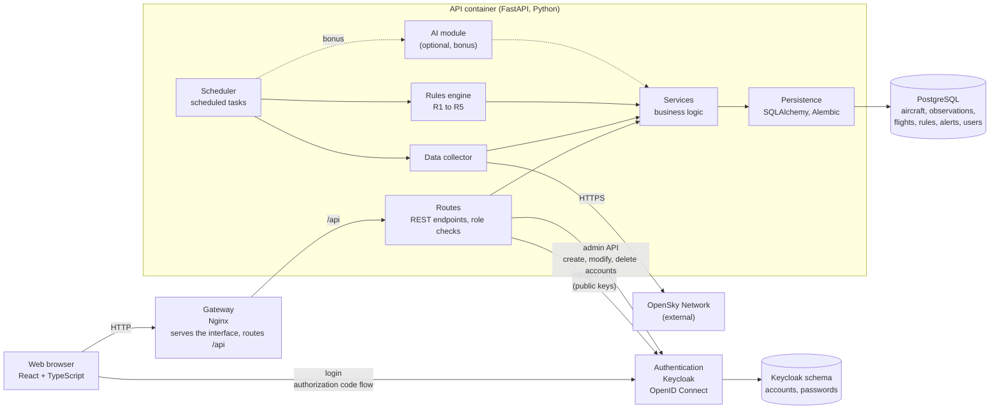

# Component diagram

Source: project sheet §8 (authentication, web interface, FastAPI API, PostgreSQL database, rules engine, optional AI module), [technology choices](../technology-choices.md) and the team decisions of 2026-11-03 listed in [open points](../open-points.md).

## Components

| Component | Role | Technology |
| --- | --- | --- |
| Web interface | Search, trajectories on a map, statistics, dashboard, alert and account management | React, TypeScript; mapping library `TBD` (D-01) |
| Gateway | Single entry point: serves the interface, routes `/api` to the API | Nginx |
| Authentication | Sign-up, login, passwords, roles `User` and `Supervisor` | Keycloak, OpenID Connect |
| Routes | REST endpoints; check the caller's role from the token before any restricted operation | FastAPI |
| Services | Business logic shared by the routes and the scheduled tasks | Python |
| Scheduler | Runs the collection and the evaluation periodically (D-05) | Inside the API process |
| Data collector | Retrieves, cleans and normalises OpenSky data | Python |
| Rules engine | Evaluates rules R1 to R5 from the thresholds stored in the database and generates alerts | Python |
| AI module | Anomaly detection and score, compared with the rules (bonus) | Python machine learning library, `TBD` (D-14) |
| Persistence | Access to the database and schema migrations | SQLAlchemy 2.0 (async), Alembic |
| Database | Stores aircraft, observations, flights, rules, alerts and users | PostgreSQL |

## Notes

- The API never handles passwords. Account creation by sign-up happens in Keycloak; the API creates the local `User` row on first login and calls the Keycloak admin API when the Supervisor modifies, deactivates or deletes an account.
- Collection and evaluation run in the API process, so there is a single backend container (team decision). A separate worker remains possible later without changing the services.
- Adding a rule or the AI module must not require reworking the existing components: the engine reads its rules from the database and the services are shared.
