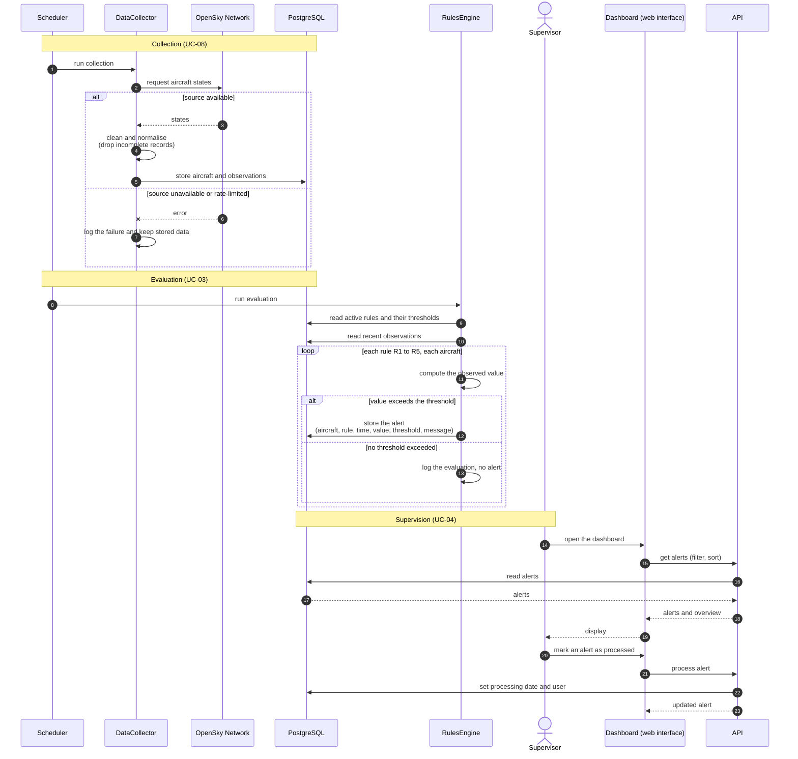

# Sequence diagram: detection and generation of an alert

Source: project sheet §4 and §6, with the team decisions of 2026-11-03 listed in [open points](../open-points.md). Data collection and rule evaluation run as scheduled tasks inside the API process. The frequency is `TBD` (D-05).

## Notes

- The Scheduler is internal to the API: no separate worker container (team decision).
- When OpenSky is unavailable, the application keeps working on the stored history, and the failure is logged (traceability of the specifications, not in the project sheet).
- Each trigger and each evaluation without alert is logged, so that an alert can be replayed and explained (specifications NF-08, not in the project sheet).
- The threshold stored in the alert is the one used at trigger time, even if the Supervisor changes the rule afterwards (UC-05).
- Marking an alert as processed records the Supervisor and the date. The database write is one transaction ([database conventions](../database-conventions.md) §10).
- If the AI module is added (bonus), it follows the same pattern: it reads the stored observations, stores an anomaly score, and may raise an alert.
