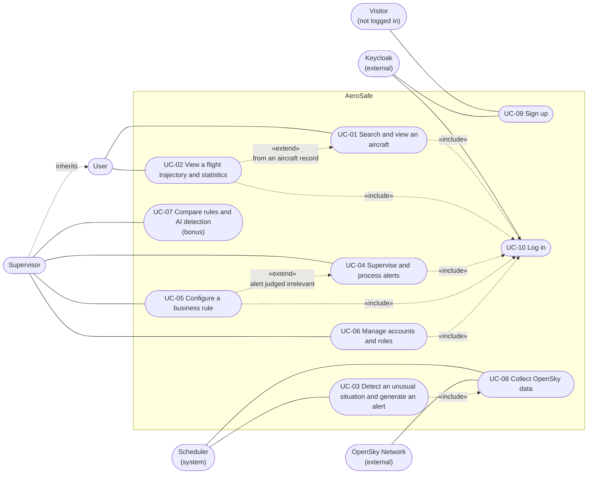

# Use case diagram

Source: project sheet §2, §3 and §9 step 1, with the team decisions of 2026-11-03 listed in [open points](../open-points.md). Mermaid has no native UML use case diagram, so this is drawn as a flowchart: stadium shapes are actors, rounded shapes are use cases, dashed arrows are `include`, `extend` and generalisation.

## Actors

| Actor | Role |
| --- | --- |
| Visitor | A person without an account. Can only sign up |
| User | Looks up and analyses aeronautical data (project sheet §3) |
| Supervisor | Supervises aircraft, business rules and alerts through the dashboard (project sheet §3). Inherits every use case of the User |
| Scheduler | Internal actor: the scheduled tasks of the API that collect data and evaluate the rules |
| OpenSky Network | External data source |
| Keycloak | External identity provider: accounts, passwords, roles |

## Use cases

| ID | Use case | Actor | Origin |
| --- | --- | --- | --- |
| UC-01 | Search for an aircraft (ICAO24, registration, airline, area) and view its record and observation history | User | Project sheet §2 |
| UC-02 | Reconstruct and view a flight trajectory on a map, with altitude and speed, and flight statistics | User | Project sheet §2, §5 |
| UC-03 | Evaluate rules R1 to R5 on the collected data and generate and store an alert when a threshold is exceeded | Scheduler | Project sheet §6 |
| UC-04 | Open the dashboard, filter and sort alerts, view an alert, mark it as processed | Supervisor | Project sheet §2, §3; processing from the specifications |
| UC-05 | View and adjust the threshold of a rule; applies at the next evaluation | Supervisor | Specifications (A-02) |
| UC-06 | Modify, deactivate or delete an account; assign a role | Supervisor | Specifications (C-05) |
| UC-07 | Compare the alerts of rules R1 to R5 with the anomaly scores of the AI model | Supervisor | Project sheet §7 (bonus) |
| UC-08 | Retrieve OpenSky data, clean and normalise it, store it in PostgreSQL | Scheduler | Project sheet §4 |
| UC-09 | Create one's own account (role User by default) | Visitor | Team decision (C-02) |
| UC-10 | Log in and out through Keycloak | All logged-in actors | Project sheet §8 (authentication component) |

UC-01 to UC-07 keep the numbering of the specifications. UC-06 no longer covers account creation by the Supervisor, since accounts are created by self sign-up (UC-09). UC-08, UC-09 and UC-10 are added here.

## Assumptions to confirm

- The Supervisor inherits every User use case, including trajectories (C-06, team decision).
- The Supervisor can modify roles, deactivate and delete accounts (C-05, team decision); creation is by self sign-up only.
- Rules are evaluated by the Scheduler, which is part of the API process (D-05: the frequency is still `TBD`).
